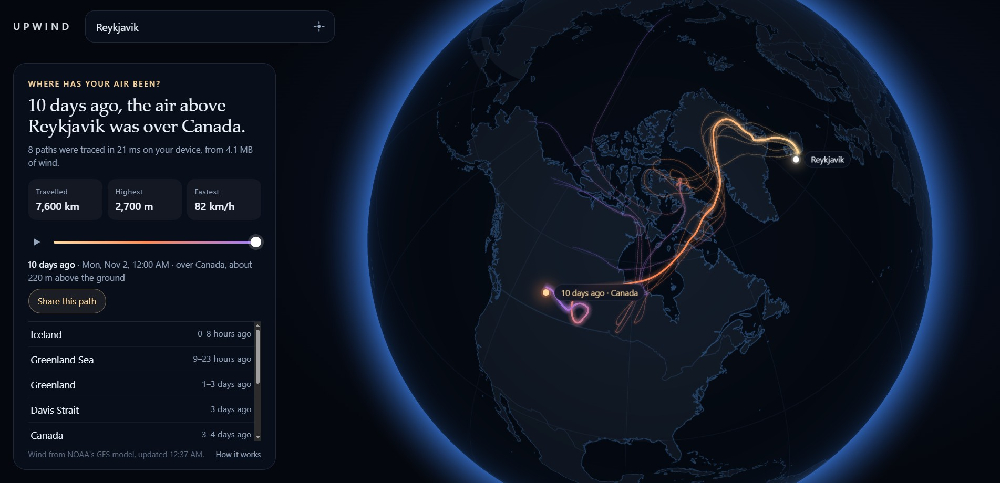
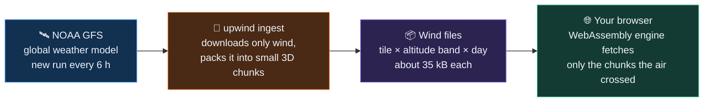

<div align="center">

# 🌬️ Upwind

### Where has your air been?

Type any place on Earth and watch the air above it travel **backwards through the last ten days**,<br>
traced through real wind data by a Rust engine running in your browser.

[](https://upwind.vercel.app)

[](https://github.com/itsHaddad/upwind/actions/workflows/ci.yml)
[](https://github.com/itsHaddad/upwind/actions/workflows/wind.yml)


[](#licence)

<a href="https://upwind.vercel.app/?lat=64.14&lon=-21.90&name=Reykjavik">
  
</a>

<sub>The air above Reykjavik, traced back ten days. The fainter lines start a little to each side and at other heights.</sub>

</div>

---

## ✨ What it does

Pick a place. Upwind takes a point 500 m above it and follows it back, hour by hour, through NOAA's global wind fields. You get:

- 🌍 **The path on a globe**, drawn above the ground at the height the air was flying.
- 📖 **The story in words**: *"10 days ago, the air above Reykjavik was over Canada"*, with every sea and country it crossed on the way.
- 🎚️ **A timeline** to scrub through the ten days.
- 🪶 **Fainter paths around the main one**, which show how sure the answer is.
- 🔗 **A link** that shows anyone the same path.

## ⚡ Why it is fast

| | |
| --- | --- |
| **~20 ms** | to trace eight air parcels back ten days, on your device |
| **79 kB** | the whole trajectory engine, compiled from Rust to WebAssembly |
| **a few MB** | of wind downloaded per trace, out of a 260 MB history |
| **every 6 h** | the wind history refreshes itself from the newest model run |

## 🛠️ How it works



- **The engine** ([`crates/core`](crates/core)) is about a thousand lines of Rust with one small dependency. It uses the predictor-corrector scheme of NOAA's [HYSPLIT](https://www.ready.noaa.gov/HYSPLIT.php) model, with winds averaged as Earth-centred vectors so paths stay accurate on curved flows and across the poles. The same code runs natively and in the browser.
- **The wind files.** The 1° global grid on 17 pressure levels is cut three ways: into tiles (wider towards the poles), into three altitude bands, and into days. A trace asks for a chunk only when the air enters it, and the engine predicts which chunks it will need next so they are already on their way.
- **The pipeline** ([`crates/tools`](crates/tools)) reads NOAA's index files and downloads only the fields it needs by byte range. Ten days of global wind build in about a minute.
- **The page** ([`web/`](web)) is TypeScript with no framework: a WebGL2 globe, the engine wrapper and the story text. Place names come from a 29 kB lookup grid built from Natural Earth.

## 🚀 Run it yourself

You need [Rust](https://rustup.rs) with the `wasm32-unknown-unknown` target and [Bun](https://bun.sh).

```sh
bun install
cargo build --release -p upwind-tools
./target/release/upwind ingest          # ten days of wind into ./data
bun run build                           # engine to WebAssembly, page to web/dist
bun run dev                             # http://localhost:4173
```

Or straight from the terminal:

```sh
./target/release/upwind trace --lat 55.70 --lon 13.19 --height 500 --hours 240
```

`bun run check` runs the formatters, linters, type check and every test.

## 🎯 How far to trust it

A back trajectory is an estimate, and it gets less certain the further back it goes. That is what the fainter paths are for: where they stay together the answer is solid, and where they fan out, read the far end as "roughly from that direction".

We compared six 120-hour trajectories (Lund, Denver and Singapore, at 500 m and 1500 m) with HYSPLIT on NOAA READY:

| Compared with | Median difference, as a share of distance travelled |
| --- | --- |
| HYSPLIT on wind of the same resolution (1°) | **23%** |
| HYSPLIT on finer wind (0.25°) | 43% |
| For scale: HYSPLIT on 1° wind against HYSPLIT on 0.25° wind | 28% |

Against the same-resolution reference, Upwind sits inside the usual 15–30% spread between trajectory models. Good to know: heights are less reliable near steep mountains, there is no turbulent mixing (this is the path of an air mass, not of each molecule), and wind every three hours on a 1° grid does not see sea breezes or thunderstorms.

## 🗂️ Layout

```text
crates/core    grid, wind file codec, interpolation, integrator (no I/O)
crates/tools   the `upwind` command: ingest, trace
crates/wasm    the engine behind a C interface, for the browser
web/           the page
scripts/       build, dev server, place-name grid
```

## 🙏 Credits

- **Wind:** NOAA Global Forecast System, from the [NOAA Open Data Dissemination](https://registry.opendata.aws/noaa-gfs-bdp-pds/) programme.
- **Method and reference:** NOAA Air Resources Laboratory's HYSPLIT model (Stein et al., 2015, *Bull. Amer. Meteor. Soc.*).
- **Coastlines, borders and sea names:** [Natural Earth](https://www.naturalearthdata.com) and [world-atlas](https://github.com/topojson/world-atlas).
- **Place search:** [Open-Meteo](https://open-meteo.com) geocoding, built on GeoNames.

## Licence

Dual-licensed under [MIT](LICENSE-MIT) or [Apache 2.0](LICENSE-APACHE), at your option. What the built page includes from other projects is listed in [THIRD-PARTY-NOTICES.md](THIRD-PARTY-NOTICES.md).
